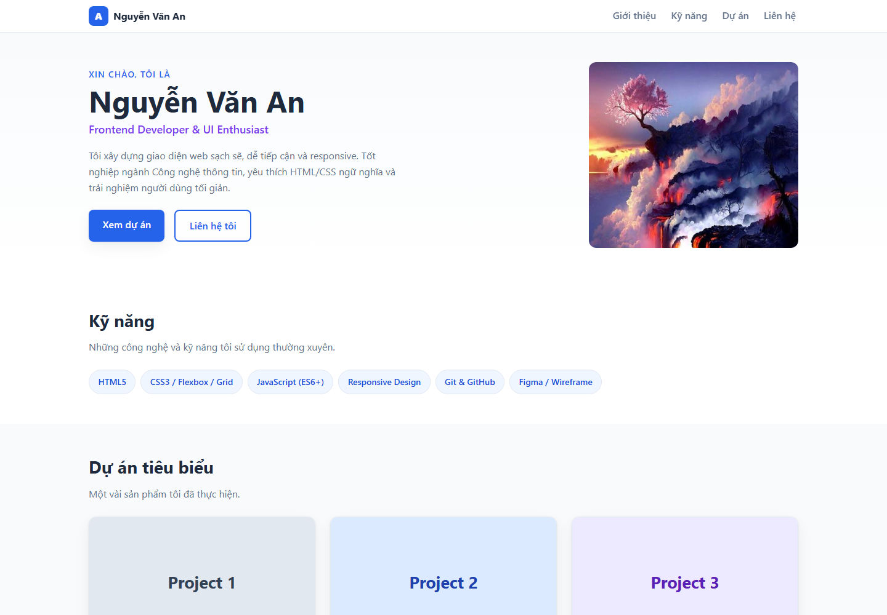

# Báo cáo kiểm thử

## Thông tin chung

- **Dự án:** Portfolio CV cá nhân Nguyễn Văn An
- **Phiên bản:** v1.0
- **Ngày kiểm thử:** 27/10/2026
- **Phạm vi:** Kiểm tra trang tĩnh `index.html` và các tài nguyên CSS, hình ảnh trong trình duyệt.
- **Môi trường:** Microsoft Edge; kiểm tra bố cục ở viewport 1440 × 1000 và 390 × 844.
- **Phương pháp:** Kiểm tra trực quan, kiểm tra DOM và thuộc tính bố cục bằng trình duyệt. Dự án không có bộ kiểm thử tự động.

## Kết quả theo tiêu chí

### 1. Tính đúng đắn — Đạt một phần

- Trang tải được; các mục Giới thiệu, Kỹ năng, Dự án và Liên hệ đều có đích điều hướng tương ứng.
- Hiển thị đủ 4 thẻ dự án và cả 5 ảnh trên trang đều tải thành công.
- Liên kết email sử dụng `mailto:` hợp lệ.
- **Chưa đạt hoàn toàn:** 4 liên kết “Xem chi tiết” và liên kết GitHub, LinkedIn hiện trỏ tới `#`, chưa mở dự án hoặc hồ sơ thật.

### 2. UI/UX — Đạt trong phạm vi đã kiểm tra

- Ở viewport 1440 px, phần giới thiệu xếp hai cột và lưới dự án có 3 cột.
- Ở viewport 390 px, lưới dự án chuyển thành 1 cột; không phát hiện tràn chiều rộng tài liệu.
- Menu điều hướng và các nút chính hiển thị; ảnh đại diện và ảnh minh họa tải được.
- Đã chụp ảnh giao diện desktop và mobile; xem minh chứng ở cuối báo cáo.
- Chưa kiểm thử trên nhiều trình duyệt, thiết bị vật lý hoặc đánh giá khả năng tiếp cận theo tiêu chuẩn chuyên biệt.

### 3. Khả năng vận hành - xử lý lỗi — Đạt có giới hạn

- Trang tĩnh mở được trực tiếp bằng trình duyệt từ tệp `index.html`.
- Các tài nguyên nội bộ được tải trong lần kiểm tra này.
- Trang không có biểu mẫu, xử lý dữ liệu, mã JavaScript hay dịch vụ backend; do đó không có luồng nghiệp vụ động để kiểm tra xử lý lỗi. Chưa thử tình huống thiếu tệp hoặc lỗi máy chủ.

### 4. Bảo mật — Đạt trong phạm vi rà soát cơ bản

- Rà soát DOM cho thấy trang không tải script, không có biểu mẫu và không tham chiếu tài nguyên script/CSS từ máy chủ bên ngoài.
- Trang không nhận dữ liệu người dùng và không có backend trong phạm vi dự án hiện tại.
- Đây **không** phải kiểm thử xâm nhập hoặc đánh giá bảo mật toàn diện; chưa kiểm tra hạ tầng triển khai, cấu hình máy chủ, dependency hay các URL đích thực tế.

### 5. Chất lượng mã nguồn — Đạt một phần

- Cấu trúc HTML có các vùng ngữ nghĩa như `header`, `nav`, `main`, `section` và `footer`; CSS được tách riêng, dùng biến, Flexbox, Grid và media query.
- Dự án không yêu cầu cài dependency hoặc biên dịch.
- **Cần cải thiện:** phần mô tả Blog có lỗi câu chữ (“bố dạng lưới”); các liên kết mẫu chưa có đích thật. Chưa có lint, kiểm thử tự động hoặc kiểm tra HTML/CSS tự động.

### 6. Khả năng triển khai — Đạt một phần

- Xác nhận trang có thể mở trực tiếp trong trình duyệt.
- README có hướng dẫn chạy máy chủ tĩnh bằng Python và Docker/Nginx.
- **Chưa xác nhận:** không chạy thử Python server hoặc Docker trong lần kiểm thử này; chưa kiểm tra triển khai lên hosting hay cấu hình tên miền/HTTPS.

## Vấn đề và việc cần làm tiếp

1. Thay các liên kết `#` bằng URL dự án, GitHub và LinkedIn thực tế.
2. Sửa câu mô tả Blog thành “Blog tĩnh với bố cục dạng lưới...” và rà soát nội dung mẫu trước khi phát hành.
3. Chạy thử quy trình Docker hoặc máy chủ tĩnh trên môi trường triển khai dự kiến.
4. Bổ sung kiểm tra tự động nếu dự án phát triển thêm chức năng.

## Minh chứng hình ảnh

Ảnh được chụp trực tiếp từ trang đang chạy bằng Microsoft Edge headless, lưu tại `docs/screenshots/`.

### Desktop — 1440 × 1000

### Mobile — 390 × 844

